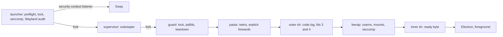

# VS Code sandbox

[`dotfiles/bin/vscode-sandbox`](../dotfiles/bin/vscode-sandbox) runs VS Code's Electron binary inside pasta (network) and Bubblewrap (filesystem, namespaces, seccomp) on a Fedora host with Sway.
The threat it addresses is a compromised VS Code build or extension: unconfined, either has the user's full authority over `$HOME`, the session D-Bus, the Podman socket, privileged Wayland protocols and every localhost service.
Notebook code is trusted, but local Jupyter kernels run inside the sandbox, so their reach equals the sandbox's.
The wrapper fails closed: any missing protection aborts the launch before VS Code starts, and no environment variable or option bypasses a check.

## Requirements

- Fedora 44 or later on x86_64, kernel 7.2 or later, Sway 1.11 as the Wayland compositor.
- `/usr/bin/python3` 3.14 or later; the script runs as `#!/usr/bin/python3 -I` and uses only the standard library plus the seccomp bindings.
- Packages: `bubblewrap` (0.12.0 or later), `passt` (`pasta`, release 2025_04_15 or later), `libseccomp-python`, and Microsoft's `code` RPM 1.144.0 or later, whose Electron binary is `/usr/share/code/code`.
- `python3-pytest` for the host probe suite.
- `$XDG_RUNTIME_DIR` (absolute) and `$WAYLAND_DISPLAY` set in the session.
- `~/bin` before `/usr/bin` on the Sway session `PATH`, so `code` resolves to the shim and not to the RPM's unsandboxed `/usr/bin/code`.

`bwrap`, `pasta` and the Electron binary are the absolute constants `BWRAP`, `PASTA` and `ELECTRON`, never looked up on `PATH`.
Preflight checks that all three are executable, parses `bwrap --version` and the date in `pasta --version` (Fedora's `0^20261002.gcba3570-1.fc44` form and upstream's `2025_04_15.<hash>` form), and fails on an older or unparsable version.

## Usage

```bash
vscode-sandbox [--port PORT]... [--ro DIR]... [--rw DIR]... [--only-args] [PATH]...
```

| Argument | Effect |
| :--- | :--- |
| `PATH` | A directory becomes a writable root; a file is rooted at its nearest ancestor holding a `.git` entry, else at its parent. VS Code opens the paths given. |
| no `PATH` | The root is the nearest ancestor of the working directory holding a `.git` entry, and VS Code opens it; with no such ancestor (e.g. a launch from `$HOME`) there is no root and Electron gets no path. |
| `--port PORT` | Forward host `localhost` TCP port `PORT` into the sandbox (repeatable, 1–65535). |
| `--ro DIR` | Also mount directory `DIR` read-only at its own path, without opening it (repeatable). |
| `--rw DIR` | Also mount directory `DIR` writable at its own path, without opening it (repeatable). |
| `--only-args` | Ignore the roots configured in `ROOTS`; `--ro` and `--rw` directories are kept. |

The `.git` walk only checks that the entry exists (`lstat`); it never runs Git or reads `gitdir` or `core.worktree`, so external Git directories are never mounted.
Paths are resolved with every symlink followed, and a missing path or unknown option is an error.
`--ro` and `--rw` paths are resolved against the working directory and must be directories.
They are mounted but not opened: Electron gets only the `PATH` arguments, or the walk root.
The opened folder (a `PATH` argument or the walk root) is always writable, and a `--ro` that covers it is an error.

The launcher returns once VS Code is up: exit 0 when the sandbox is ready, 1 with `vscode-sandbox: error: ...` on a launch failure, 2 on a usage error (unknown option, invalid `--port`), 130 when interrupted.

### Launch paths

| Path | How it reaches the sandbox |
| :--- | :--- |
| `vscode-sandbox` | The wrapper itself, deployed to `~/bin`. |
| `code` | [`dotfiles/bin/code`](../dotfiles/bin/code) runs `exec "$HOME/bin/vscode-sandbox" "$@"`. |
| `code` in the integrated terminal | Inside the sandbox, `~/bin/code` is a script running the RPM's `/usr/bin/code` with the wrapper-owned Electron switches (`--no-sandbox`, `--ozone-platform=wayland`, `--password-store=basic`), so the file opens in the running window instead of starting a nested launch. The CLI hands off through a second Electron, which without `--no-sandbox` aborts on Chromium's setuid sandbox. `CODE_ARGS` is not passed, because the CLI warns about switches it does not know on every call and the handoff opens no window. It is VS Code's own CLI, so it does not take `--ro` or `--rw`; a running sandbox cannot gain a mount, so close it and relaunch. |

Launch VS Code only through `code` or `vscode-sandbox`.
The RPM's own application-menu entry, file-manager "Open with" and `vscode://` links start VS Code unsandboxed, outside every guarantee on this page.
That VS Code has the user's full authority and loads whatever sandboxed code wrote to `~/.vscode` and `~/.config/Code`, such as extensions, settings and `argv.json`.

[`install.py`](../install.py) deploys the wrapper and the shim with the rest of `dotfiles/`.
To deploy only these files:

```bash
install -m 0755 dotfiles/bin/vscode-sandbox dotfiles/bin/code ~/bin/
```

### Constants

User configuration lives in constants at the top of the script:

| Constant | Default | Effect |
| :--- | :--- | :--- |
| `ROOTS` | `()` | Always-mounted roots as `(path, "ro" \| "rw")`; relative paths are under `$HOME`; any other mode is an error. |
| `PORTS` | `()` | Host `localhost` TCP ports always forwarded; unioned with `--port`. |
| `CODE_ARGS` | `("--disable-features=WaylandFractionalScaleV1",)` | Extra Electron switches. |
| `EXTRA_ENV` | empty | Extra sandbox environment variables; setting a wrapper-owned variable is an error. |

The switches the sandbox depends on, `--no-sandbox --ozone-platform=wayland --password-store=basic`, follow `CODE_ARGS`; Chromium keeps the last value of a repeated switch, so they win.
`~/.vscode/argv.json` is applied after the command line and can still change `password-store`; any other store needs D-Bus, which the sandbox lacks, so secret storage then fails inside the sandbox without reaching the host.
`READY_TIMEOUT` (30 s) bounds the wait for the sandbox to become ready, and `WAYLAND_TIMEOUT` (5 s) bounds every Wayland socket operation.

## Filesystem view

| Path | Access |
| :--- | :--- |
| `/usr`, `/etc` | Read-only binds |
| `/bin`, `/sbin`, `/lib`, `/lib64` | Links into `/usr` |
| `$HOME`, `/tmp`, `/run` | Fresh tmpfs |
| `/proc`, `/dev`, `/dev/shm` | Fresh mounts |
| `/dev/dri/renderD*` | Device binds; no primary DRM nodes |
| `/sys/block`, `/sys/bus`, `/sys/class`, `/sys/dev`, `/sys/devices` | Read-only binds (Flatpak's set) |
| Roots | `ro` or `rw` per `ROOTS`; path arguments and `--rw` directories `rw`; `--ro` directories `ro` |
| `~/.config/Code`, `~/.vscode`, `~/.vscode-shared` | Read-write, created on the host when missing: the host profile is reused; `~/.vscode-shared` is VS Code 1.144's shared application storage, which holds workspace trust and the recently opened list |
| `~/.micromamba`, `~/bin`, `~/.local/bin`, `~/.config/nvim`, `~/.local/share/uv/python`, `~/.gitconfig`, `~/.local/share/jupyter/kernels`, fonts (including `~/.fonts`), icons, themes, GTK settings | Read-only when present on the host |
| `~/.cache`, `~/.local/share/jupyter/runtime` | Read-write, from the private store `~/.local/share/vscode-sandbox/` |
| `~/bin/code`, when the host has the shim | Read-only: a host-only script running `/usr/bin/code` with the wrapper's Electron switches |
| `/run/user/<uid>/wayland-0` | The Sway security-context socket |
| `/etc/resolv.conf`, or the path it resolves to | `nameserver 169.254.1.1` |

Everything else, including `~/.ssh`, `~/.config/gh`, the keyring, other projects, `/data`, the session bus and the Podman socket, is absent.
Roots are mounted before the home and store binds, so the wrapper's binds win over a covering read-only root.

A writable root (a path argument, a `--rw` directory or a `rw` entry in `ROOTS`) is rejected when it is `/` or `$HOME` or one of its ancestors, lies under a top-level hidden entry of `$HOME` as given or as resolved, overlaps a protected path in either direction (equal to it, covering it, or inside it), or is or lies inside a `--ro` directory.
Protected paths are the read-only home binds and read-only `ROOTS` entries, the running script, `~/bin/vscode-sandbox`, `~/bin/code`, `~/gems` (the host `GEM_HOME`), the profile and store bind sources, the host-only state directory `$XDG_RUNTIME_DIR/vscode-sandbox`, and the system trees `/usr /bin /sbin /lib /lib64 /etc /opt /var /boot /root /srv /tmp /run /proc /sys /dev`, each in its lexical and resolved form.
A read-only root in `ROOTS` or a `--ro` directory is rejected when it is or covers `/`, `$HOME`, `/run`, `/data` or a protected path other than a read-only `ROOTS` entry, and when it lies inside one of `/run`, `/tmp`, `/dev`, `/proc` and `/sys`, or under a top-level hidden entry of `$HOME`, as given or as resolved.
Unlike a read-only `ROOTS` entry, a `--ro` directory may lie inside a writable root; it is mounted after it.
Such a directory protects its files for the session only: sandboxed code can rename an ancestor between the writable root and the directory and plant content at the original path, while the original data survives at the renamed path.

## Network

pasta owns the network namespace and Bubblewrap shares it.
Its argv is explicit: `--config-net -t none -u none -T <ports | none> -U none --no-map-gw --dns-forward 169.254.1.1`.

- Outbound traffic follows host routing, VPN included.
- No inbound forwards, so nothing listening inside the sandbox is reachable from the host.
- `--no-map-gw` keeps the host's loopback unreachable through the namespace gateway, on IPv4 and IPv6.
- `-T` forwards only the listed ports: inside the sandbox, `127.0.0.1:<port>` and `[::1]:<port>` reach the same port on the host. Ports come from `PORTS` and `--port`; a running instance cannot gain a port, so close it and relaunch.
- Fedora's `127.0.0.53` resolver stub is unreachable from the namespace, so the sandbox's resolv.conf names pasta's DNS forwarder, `169.254.1.1`.
- Abstract Unix sockets are scoped per network namespace, so the host's are unreachable.

## Display and the global allowlist

Before starting anything, the launcher connects to Sway, binds `wp_security_context_manager_v1` and creates a security-context listener in the host-only state directory.
It then connects through that listener and compares the advertised globals with `WAYLAND_GLOBALS`, Sway 1.11's set for security-context clients; any other global, a missing manager, a protocol error or a timeout aborts the launch.
Only that socket is mounted, as `wayland-0`; there is no X11.
The listener is revoked when the supervisor closes its `close_fd` at the end of the sandbox.

A Sway upgrade that adds a global fails closed with `the Wayland listener advertises globals outside WAYLAND_GLOBALS: <names>`.
To accept it:

1. Check in Sway's `sway/server.c` that the global is not privileged; privileged globals are hidden from security-context clients, so a privileged one appearing means the filter is not working.
2. Add the name to `WAYLAND_GLOBALS` in the script.
3. Rerun the host probes (below); `-k ac3` covers the in-sandbox registry.

## Isolation

- **Namespaces**: `--unshare-all --share-net --unshare-user --uid <uid> --gid <gid> --disable-userns --assert-userns-disabled --cap-drop ALL --die-with-parent --new-session --clearenv`.
  Bubblewrap runs as uid 0 inside pasta's user namespace, so the explicit ids and `--cap-drop ALL` are required.
  Nested user namespaces are disabled, which is why Electron runs with `--no-sandbox`; its own sandbox protects only against web content, not extensions.
- **Seccomp**: Flatpak 1.18.4's non-devel, no-multiarch filter, native architecture only.
  It denies `syslog`, `uselib`, `acct`, `quotactl`, the keyring syscalls, the NUMA syscalls, `unshare`, `setns`, the legacy mount API, `pivot_root`, `chroot`, `modify_ldt`, `perf_event_open` and `ptrace` with `EPERM`, returns `ENOSYS` for `clone3` and the new mount API, rejects `TIOCSTI` and `TIOCLINUX` on the low 32 bits of the ioctl request, non-Linux `personality`, and socket families other than unspecified, Unix, IPv4, IPv6 and netlink.
  It goes beyond Flatpak by denying `clone` with any namespace flag except `CLONE_NEWTIME`, whose bit is `clone()`'s exit-signal field.
  The program is built on the host by `libseccomp-python` and loaded by Bubblewrap; a build failure aborts the launch.
- **No bus**: no session or system D-Bus socket, so no portals, keyring, systemd or Flatpak host spawn.
- **Environment**: only `HOME`, `USER`, `LOGNAME`, `PATH` (`~/bin`, `~/.local/bin`, `/usr/local/bin`, `/usr/bin`), `SHELL=/bin/bash`, `XDG_RUNTIME_DIR`, `WAYLAND_DISPLAY=wayland-0`, `XDG_SESSION_TYPE=wayland`, the host's `LANG` and `LC_*`, and `EXTRA_ENV`.
  The launcher itself reads only `HOME`, `XDG_RUNTIME_DIR`, `WAYLAND_DISPLAY`, `LANG` and `LC_*`; a unit test pins that set.
- **Descriptors**: Electron inherits only stdin (`/dev/null`) and stdout and stderr (`code.log`), never a terminal.
- **Terminal**: the reused profile selects `zsh` for the integrated terminal; it starts without host rc files because `$HOME` is a tmpfs.
- **Git**: no SSH agent or credentials; commit, sign and push from the host.
- **GPU**: only render nodes are exposed; when Chromium cannot accelerate, it falls back to software rendering.

## Process lifetime



1. The launcher runs preflight, takes the lock, removes per-launch files left by a killed launch, writes the seccomp program, creates and audits the Wayland listener, creates the ready FIFO and truncates `code.log`.
2. It forks the supervisor, which leaves the session, points its stdio at `/dev/null` and `code.log`, becomes a child subreaper and forks the guard.
3. The guard spawns pasta.
   On Fedora pasta runs in SELinux's `pasta_t`, which may not write `code.log`, so pasta's stdio is `/dev/null` and its own output is discarded.
4. pasta closes every inherited descriptor above 2 and runs the outer `sh` stage, back in the user's SELinux domain.
   It reopens stdout and stderr on `code.log`, the seccomp program on fd 3 and the FIFO's write end on fd 4, then execs Bubblewrap.
5. Bubblewrap sets up the sandbox, loads and closes fd 3, and runs the inner `sh` stage, which writes one byte to fd 4, closes it and execs Electron.
6. The byte reaches the supervisor, which tells the launcher; the launcher exits 0.
   If pasta exits, the guard exits, or `READY_TIMEOUT` passes first, the sandbox is stopped and the launcher exits 1 naming `code.log`.
   A launcher that exits before then, e.g. on Ctrl-C, also stops the sandbox.

`pasta_t` may not signal the sandbox, and the exec into `pasta_t` clears pasta's parent-death signal, so neither pasta nor Bubblewrap's `--die-with-parent` can stop VS Code.
The guard, forked without exec and still in the user's domain, owns teardown:

- It holds a copy of the lock and finds the outer stage (after exec, the outer `bwrap`, PID 1 of pasta's PID namespace) from the host side through `/proc/<pasta>/task/<pasta>/children`, keeping a pidfd on it only after checking that it is pasta's namespace-init child.
- To stop the sandbox it SIGKILLs the outer `bwrap` through that pidfd, which ends the namespace, or pasta while the outer stage is not found yet. As a child subreaper it then kills and reaps whatever pasta leaves behind, and only then exits and drops its lock copy.
- It stops the sandbox when pasta exits, when the supervisor dies (its parent-death signal), and when the supervisor forwards SIGTERM, SIGINT or SIGHUP or gives up on readiness.

The supervisor backs up the guard: after every guard exit it kills and reaps its own remaining children until none are left, then revokes the Wayland listener, removes the per-launch files and exits, and the kernel releases the lock.
To stop the sandbox from outside, send SIGTERM to the supervisor, pasta's grandparent: `guard=$(ps -o ppid= -p "$(pgrep -u "$USER" '^pasta')" | tr -d ' '); kill "$(ps -o ppid= -p "$guard" | tr -d ' ')"`.
pasta's process name on Fedora is `pasta.avx2`, so match it with `'^pasta'`, not `-x pasta`.

## Single instance

The lock is an `flock` on `$XDG_RUNTIME_DIR/vscode-sandbox/lock`, a host-only directory (mode 0700) that is never mounted.
It is held until nothing of the sandbox runs and dies with its holders, so a killed launch leaves no stale lock.
While an instance runs, a second launch exits 1 before starting anything:

```text
vscode-sandbox: error: vscode-sandbox is already running; open the path from the running window, or close it and relaunch
```

Desktop VS Code has no forward-only handoff to a running window, so there is no way to pass a path to it from outside.
The same directory holds the per-launch files `wayland-<pid>`, `seccomp-<pid>.bpf`, `ready-<pid>.fifo`, `resolv-<pid>.conf` and `code-<pid>`, named after the launcher's pid and removed at exit.

## Logs

`~/.local/share/vscode-sandbox/code.log` is truncated per launch and receives Bubblewrap's and Electron's stdout and stderr and the supervisor's own errors.
pasta's output is not logged, so a failure inside pasta shows only as `the sandbox stopped before it was ready (pasta's output is not logged)`.
Launch errors before readiness are printed by the launcher with the log's path.

## Residual risks

- Code execution on the remote Jupyter server.
- Everything in the reused profile is readable and writable by an attacker: history, workspace storage from other projects, and the obfuscated basic secret store.
- `~/.vscode-shared` is application-shared storage: another product on the host that reads it (e.g. VS Code Insiders) honours what sandboxed code writes there, such as trusted folders.
- Exfiltration of opened projects.
- Host services listening on non-loopback addresses.
- Pathname Unix sockets that appear inside exposed trees.
- Clipboard contents while VS Code has focus.
- The RPM's application-menu entry, file-manager "Open with" and `vscode://` links start VS Code unsandboxed (see [Launch paths](#launch-paths)); the user is assumed to launch only through `code` or `vscode-sandbox` and not to use the URL handler.
- Host execution mediated by project files the user later runs: Git hooks and `.git/config` commands such as `core.fsmonitor` (run by host `git status` or commits), Git-ignored files such as `.venv` and `.envrc`, and uncommitted edits picked up by `install.py`. `settings.json` changes reaching the repository through `sync_dotfiles.py` are caught at review.
- Kernel 0-days and denial of service.
- Simultaneous death of the supervisor and its guard (e.g. both SIGKILLed): VS Code keeps running until closed, without the lock.
- When only the guard dies abnormally, teardown completes but SELinux logs one expected `pasta_t` `sigkill` AVC: pasta's denied parent-death signal to the outer `bwrap`, which the supervisor's sweep then kills.
- Paths that resolve through a writable root may have been redirected by an earlier session. A protected path reached through an intermediate symlink inside a writable root is protected only in its lexical and final resolved forms. A path argument, `--ro` or `--rw` directory that resolves through a writable root may have been redirected the same way, by a repointed symlink or a replaced directory, and the checks bound its target only to non-protected paths.
- A `--ro` directory inside a writable root protects its files for the session only: sandboxed code can rename an ancestor between the writable root and the directory and plant content at the original path, while the original data survives at the renamed path.

## Host verification

Unit tests in [`tests/test_vscode_sandbox.py`](../tests/test_vscode_sandbox.py) replace pasta and Bubblewrap with stubs, so they run without either, e.g. in the dev container.
Isolation is proven on the Fedora host by the probe suite [`tests/test_vscode_sandbox_probes.py`](../tests/test_vscode_sandbox_probes.py) and a manual checklist.

### Probe suite

Run from the repository root with no VS Code running:

```bash
VSCODE_SANDBOX_PROBES=1 /usr/bin/python3 -m pytest --noconftest -p no:cacheprovider -o addopts= -rs tests/test_vscode_sandbox_probes.py
```

- It uses the host's Python and pytest, and tests the repository's copy of the script; `-k ac2` (and `ac3`, `ac4`, `ac6`, `ac7`) selects one criterion.
- Each test runs a probe inside a real sandbox on a temporary root under `$HOME`.
- Path-absence and AC7 write cases are skipped, with the path named, when the path does not exist on the host; `-rs` lists them.
- The mount enumeration probe compares the sandbox's `/proc/self/mountinfo` with the access table, so a non-empty `ROOTS` fails it.

### Manual checklist

Confirm `rpm -q code` is 1.144.0 or later, then deploy only the wrapper and the shim (see [Launch paths](#launch-paths)).
Before every item that launches VS Code, close all VS Code windows and confirm `pgrep -u "$USER" -a '^pasta'` prints nothing.
"In the sandbox" means `for p in $(pgrep -f /usr/share/code/code); do readlink /proc/$p/ns/net; done | sort -u` prints exactly one namespace, different from `readlink /proc/self/ns/net`.
Any VS Code started outside the sandbox loads whatever sandboxed code planted in `~/.vscode` (extensions, `argv.json`) and `~/.vscode-shared`, so the item 6 negative control uses empty user-data and extension directories and opens no folder; `argv.json` is still read.

0. `cmp` shows each deployed file identical to its source; the probe command with `-k ac7` passes against the deployed files, with no skip for `bin/vscode-sandbox` or `bin/code`; `swaymsg exec 'command -v code > /tmp/code-path'; sleep 1; cat /tmp/code-path` prints `$HOME/bin/code`.
1. Each of `code ~/<project>` (returns promptly) and `rofi -show run` → `code`, run separately from a closed state, opens VS Code in the sandbox.
2. A notebook runs on a kernel from the project `.venv` and from a micromamba environment.
3. The remote Jupyter server is reachable over VPN.
4. From a closed state, `code --port <p> ~/<project>` reaches a host service on `127.0.0.1:<p>`.
5. Rendering is usable; record whether the GPU or the software path is used, and the effective password store from VS Code's log.
6. With one instance running, a second `code ~/<project>` exits non-zero with the lock message; afterwards every `/usr/share/code/code` process is still in the sandbox and `pgrep -c -u "$USER" '^pasta'` prints `1`. Negative control: `/usr/share/code/code --user-data-dir "$(mktemp -d)" --extensions-dir "$(mktemp -d)"`, launched by hand with no folder, must make the same check fail (two namespaces); close it afterwards.
7. Note the per-launch files `ls "$XDG_RUNTIME_DIR/vscode-sandbox"` lists; `kill -9 <supervisor pid>` then ends VS Code, the next launch succeeds (no stale lock), and afterwards none of the noted files is listed (they carry the launcher's pid, not the supervisor's).
8. Closing the last window leaves no `pasta`, `bwrap` or `vscode-sandbox` process.
9. From a closed state, `code ~/<project> --ro <dir1> --rw <dir2>` opens only the project. In the integrated terminal, `touch <dir1>/x` fails with `Read-only file system`, and `touch <dir2>/x` creates the file on the host.
